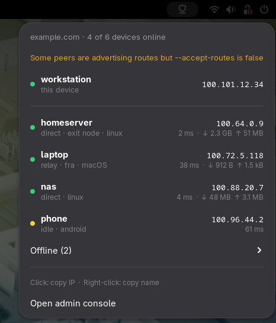

# Tailscale Peers

A GNOME Shell extension that shows whether Tailscale is connected and lists the devices in your tailnet in a panel menu. Click a device to copy its Tailscale IP.



## Why this exists

`tailscale status` tells you everything, but you have to open a terminal and read a table. Most of the time you only want to know two things: *am I connected?* and *what's the IP of that machine?* This extension puts both one click away in the top bar.

It is deliberately read-only. There is no on/off switch, no exit node picker and no settings. Other extensions already do that. This one focuses on **showing** the state of your tailnet:

- **Panel icon:** connected, stopped, starting or logging in, or unavailable (tailscaled not running or CLI missing).
- **For each device:**
  - 🟢 online with a **direct** connection, through a **relay** (with the DERP region, e.g. `relay · fra`), or through a **peer relay**
  - 🟡 online but **idle** (no active connection right now)
  - ⚪ offline, with **last seen** time
  - which peer is your **exit node** and which peers can be one
  - the device's OS
  - **latency**, measured with a single `tailscale ping` to each online device when you open the menu (cached for 30 s, 2 s timeout)
  - **traffic** to and from the device (`↓ received  ↑ sent`) as reported by `tailscale status` (WireGuard counters, which reset when `tailscaled` restarts or an idle peer connection is torn down)
- **Health warnings** reported by Tailscale.
- **Click** a device to copy its Tailscale IPv4 address; **right-click** it to copy its MagicDNS name (e.g. `laptop.tail1234.ts.net`).

The menu refreshes every 10 seconds, and again each time you open it. Pings only run while the menu is open.

## Requirements

- GNOME Shell 48, 49 or 50
- The `tailscale` CLI on your `PATH`, with `tailscaled` running

The extension only runs `tailscale status --json` and `tailscale ping`, which any user can run. You do **not** need `tailscale set --operator=$USER` or sudo.

## Installation

From [extensions.gnome.org](https://extensions.gnome.org/) (once published), or from source:

```sh
make install
# log out and back in (required on Wayland), then:
gnome-extensions enable tailscale-peers@ekorre.hr
```

## Development

On Wayland, GNOME only loads new or changed extension code at login. To test without logging out, you can run a throwaway headless shell with its own D-Bus session:

```sh
export GSETTINGS_BACKEND=memory       # IMPORTANT: otherwise the test shell writes to your real dconf
export XDG_DATA_HOME=$(mktemp -d)     # extensions dir for the test shell
mkdir -p $XDG_DATA_HOME/gnome-shell/extensions
ln -s $PWD/tailscale-peers@ekorre.hr $XDG_DATA_HOME/gnome-shell/extensions/
dbus-run-session -- bash -c '
  gnome-shell --headless --virtual-monitor 1600x900 --wayland-display test --no-x11 --unsafe-mode &
  sleep 10
  gdbus call --session -d org.gnome.Shell -o /org/gnome/Shell \
    -m org.gnome.Shell.Extensions.EnableExtension tailscale-peers@ekorre.hr
  # --unsafe-mode allows org.gnome.Shell.Eval, e.g. to open the menu and take a screenshot
  wait'
```

Set the variables **before** `dbus-run-session`, so that services the private bus starts (such as dconf) inherit them too.

## Building a release

```sh
make pack   # → tailscale-peers@ekorre.hr.shell-extension.zip, ready to upload to extensions.gnome.org
```

## License

GPL-2.0-or-later. See [LICENSE](LICENSE).

Tailscale is a trademark of Tailscale Inc. This project is not affiliated with or endorsed by Tailscale Inc.
